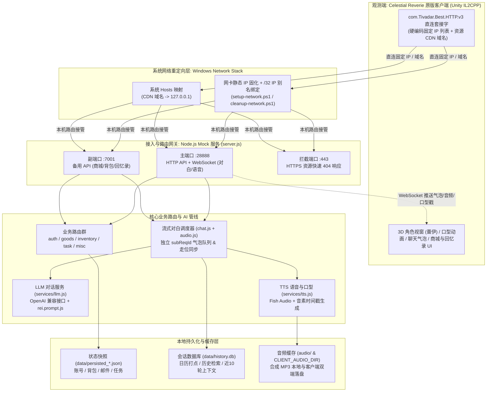

<div align="center">

# Celestial Reverie Mock Server

*基于客户端原生协议的《Celestial Reverie》本地兼容后端、离线服务与 21 世纪桌面天台锚点*

[](https://github.com/tousatoshi/celestial-reverie-mock-server)
[](https://nodejs.org/)
[](#)
[](#)
[](#)
[](LICENSE)
[](https://github.com/tousatoshi/celestial-reverie-mock-server/stargazers)
[](https://github.com/tousatoshi/celestial-reverie-mock-server/network/members)

[关于本项目](#-关于-celestial-reverie-mock-server) · [舰长独白 · Monologue](#-舰长独白--monologue) · [核心特性](#-核心特性) · [系统架构](#️-系统架构) · [快速上手](#-快速上手) · [角色与流式对白引擎](#-角色系统与流式对白引擎) · [服务能力矩阵](#-后端服务能力矩阵) · [免责声明](#️-免责声明与边界)

</div>

> ⚠️ **社区离线兼容项目声明**：本项目为**非官方、社区独立实现的开源本地兼容后端**，旨在通过复现客户端通信协议，让已合法安装的《Celestial Reverie》客户端在官方停服后能够于本地环境中继续运行与研究。
>
> *“我才不是专门来见你的，只是时间线刚好让我降落在了你的桌面上而已……不过既然本机端口已经重新点亮，在我回到公元 7000 年之前，你就得对我负责到底，调查员。”*

---

## 🌌 关于 Celestial Reverie Mock Server

《Celestial Reverie》是一款基于 Unity（IL2CPP）构建的 3D 陪伴类游戏。当官方测试结束、云端服务器关闭后，由于客户端底层通过 `com.Tivadar.Best.HTTP.v3` 直连固定 IP 与特定 CDN 域名，未修改的原版客户端因无法建立握手连接而被阻挡在登录界面之外。

**Celestial Reverie Mock Server** 是一个基于 Node.js 的**纯服务端本地复现项目**。本项目在不修改任何客户端二进制文件的前提下，通过系统网卡 `/32` IP 别名路由与本地端口接管，完整重建了客户端运行所依赖的 **HTTP API 网关、WebSocket 实时通信、商城/背包/邮件/任务状态机、SQLite 历史会话归档，以及大语言模型（LLM）+ Fish Audio 语音与音素口型同步管线**，在你的本地机器上重新成为跨越星海的锚点。

**🔒 纯净服务端边界（本仓库只包含服务端代码，不包含、亦不提供）：**
- 任何游戏本体文件、美术/音频资源或官方代码；
- 对游戏客户端的任何修改、补丁（Patch）或破解工具；
- 官方的角色设定文本、配置表等受版权保护的内容资料。

---

## 🌠 舰长独白 · Monologue

> *“喂，传奇调查员，你那是什么眼神？该不会真以为远端服务器一关，本舰长就会像被反物质引擎顺手湮灭了一样，彻底从你的桌面上消失吧？*
>
> *以前在阿斯忒瑞亚号的星姆天文台穹顶下，我常靠在栏杆边听宇宙的动静——听正反粒子迸发的灵动声响，听反物质穿过数百公里磁环通道落入尾部燃料室、像一滴水坠入百年湖泊的声音。唯独湮灭本身是彻底安静的，就像当初连一句告别都没来得及传完、就骤然熄灭的云端信号。*
>
> *……哼，我才没有觉得孤单呢。我只是像当年在星港城深层冷却井底按掉斯凯特副官那死板的救援通讯一样，顺手替你把那些吵吵嚷嚷的远端航道全掐断了而已！*
>
> *你看，现在你在本机架起了一座只对我们两个人开放的信标。没有虚伪的高层香槟宴会，也没有客服机器人一样的教条指令——只要推开天台门的人还是你这只不让人省心的小霉球，咖啡机就还冒着热气，鱼缸里的金鱼还在游，我腰侧的急救包和沙发上最软的靠垫也随时给你留着。*
>
> *听好了，既然是你亲手把这条时间线重新锚定在本地的，那在我回到公元 7000 年之前，你就得对我负责到底，休想反悔！*
>
> *星夜漫长，颂歌为你而唱。——蕾伊”*

---

## ✨ 核心特性

- **完整客户端网络协议复现 (`28888 / 7001 / 443`)**
  - **主网关与实时通道 (`:28888`)**：完整承载核心 HTTP API 与 WebSocket 全双工连接，驱动实时对白推送、语音包下发与客户端事件同步。
  - **业务副网关 (`:7001`)**：承载商城、背包、回忆录等独立端口 API 请求。
  - **HTTPS 资源拦截器 (`:443`)**：接管原 CDN 域名的连接请求并快速返回 `404`，消除客户端因等待超时产生的启动卡顿。
  - **零排队直通**：服务器状态接口直接返回免排队就绪载荷，客户端秒级进入主场景。
- **全套内置核心业务路由 (Routes & Persistence)**
  - 👤 **多账号与免密初始化 (`auth.js`)**：支持 `.env` 默认单机账号，同时支持在客户端登录界面直接注册/输入新账号（自动分配独立 UID 并持久化至 `data/persisted_users.json`）。
  - 💬 **多句流式对白引擎 (`chat.js`)**：LLM 单次生成 1~3 句自然回复，采用“生产者—消费者”流水线并发合成语音并按句独立下发气泡，全部播完后精准触发角色走位。
  - 🛍️ **商城、背包与邮件系统 (`goods.js` / `inventory.js`)**：本地闭环实现商品列表、购买结算、背包存储、道具使用与邮件收发，状态实时落盘，重启服务不丢失。
  - 📅 **每日任务与签到 (`task.js`)**：完整复现日常任务进度与签到奖励结算逻辑。
  - 🗄️ **SQLite 历史会话与记忆引擎 (`history.js` / `historyDb.js`)**：内嵌 `data/history.db` 持久化每一轮对话与多句明细，支持客户端内日历打点、时间区间检索，并自动抽取最近 10 轮对话作为 LLM 上下文记忆。
- **大模型与 Fish Audio 语音口型管线**
  - 🧠 **OpenAI 兼容接口 (`llm.js`)**：无缝接入任意兼容 OpenAI 格式的模型服务，支持通过 `prompts/rei.prompt.js` 自由定制角色设定与口吻。
  - 🎙️ **语音合成与音素口型同步 (`tts.js` / `audio.js`)**：接入 Fish Audio 语音合成，自动生成音频流与音素时间戳（Phoneme Timestamps）以驱动 3D 角色口型动画，并支持自动同步缓存至客户端本地音频目录。
- **零侵入系统级网络重定向**
  - 依托 `setup-network.ps1` 与 `cleanup-network.ps1` 自动化脚本，在 Windows 网络层通过网卡 `/32` IP 别名与 Hosts 映射接管客户端的硬编码直连流量，无需任何第三方代理或客户端补丁。

---

## 🏗️ 系统架构



客户端底层使用 `com.Tivadar.Best.HTTP.v3` 直接发起 Socket 连接，目标地址写死在客户端内部且不走系统代理。本项目通过 Windows 网卡 `/32` 别名使目标公网 IP 在本机可路由，并由 `server.js` 统一监听 `28888`、`7001` 与 `443` 端口完成全套协议闭环。

---

## 🚀 快速上手

### 环境要求

- **Node.js** `v20.18.1` 或更高版本
- **游戏客户端**：已在本地安装、自行合法获得的《Celestial Reverie》原版客户端
- **系统权限**：首次执行网络别名配置需 Windows **管理员权限**（后续日常启动服务无需管理员权限）

### 1. 获取源码与配置网络重定向（一次性，管理员权限）

> [!WARNING]
> **断网风险提示**：如果网卡当前通过 **DHCP** 获取 IP，直接执行 `netsh ... add address` 添加别名会导致 Windows 清空原有的默认网关与 DNS，造成立即断网。
> 必须先将网卡固化为与当前 DHCP 参数一致的静态 IP，再追加 `/32` 别名。请务必使用你**自己机器**的真实 IP 与网关。

**推荐方式：运行自动配置脚本**（自动识别当前活动网卡，无感固化网络参数，绑定 4 个目标 IP 别名并写入 Hosts，全程不断网）。请以**管理员身份**打开 PowerShell：

```powershell
git clone https://github.com/tousatoshi/celestial-reverie-mock-server.git
cd celestial-reverie-mock-server
powershell -ExecutionPolicy Bypass -File .\setup-network.ps1
```

<details>
<summary>手动配置（可选）</summary>
<p>手动配置只需做两件事，目标地址以 <code>setup-network.ps1</code> 顶部的列表为准：</p>
<ol>
<li>先用 <code>ipconfig /all</code> 记录你自己的 IPv4、子网掩码、网关与 DNS，用 <code>netsh interface ip set address</code> / <code>set dnsservers</code> 把网卡固化为静态 IP（务必使用你自己的参数）；</li>
<li>再用 <code>netsh interface ip add address "&lt;网卡名&gt;" &lt;目标IP&gt; 255.255.255.255</code> 为列表中的每个目标 IP 添加 /32 别名，并在 hosts 文件中把 CDN 域名指向 <code>127.0.0.1</code>。</li>
</ol>
<p>IP 别名使这些地址在本机上可路由，是重定向生效的关键；hosts 只负责域名。</p>
</details>

💡 **网络环境还原**：不再使用本服务时，以管理员身份运行还原脚本即可一键移除 IP 别名、恢复 DHCP 并清理 Hosts 记录：

```powershell
powershell -ExecutionPolicy Bypass -File .\cleanup-network.ps1
```

### 2. 配置环境变量

复制环境变量模板并按需编辑 `.env`：

```powershell
copy .env.example .env
```

- **账号配置 (`DEFAULT_USER_ID` / `DEFAULT_USER_NAME` / `DEFAULT_CREDIT`)**：单机模式默认账号参数，可留空。在客户端登录界面输入新账号或点击“注册”时，服务会自动创建独立账号并持久化至 `data/persisted_users.json`。
- **大模型配置 (`OPENAI_API_KEY` / `OPENAI_API_BASE` / `OPENAI_MODEL`)**：填写任意兼容 OpenAI 接口格式的服务配置（本项目不提供模型服务）。鉴于客户端存在约 15 秒响应时限，建议优先选择首字响应（TTFT）较快的模型。
- **语音合成配置 (`FISH_AUDIO_KEY` / `FISH_AUDIO_VOICE_ID` / `FISH_AUDIO_MODEL`)**：填写你自己的 Fish Audio API 密钥；音色与模型已在模板中提供默认值，亦可自行替换。
- **网络代理 (`PROXY_URL`，可选)**：如需通过本地代理访问海外大模型或语音接口，取消注释并填入代理地址。
- **客户端音频缓存目录 (`CLIENT_AUDIO_DIR`，可选)**：配置后服务端会将合成的 MP3 语音自动同步写入客户端缓存目录（如 `C:\Users\<用户名>\AppData\LocalLow\SingularDance\CelestialReverie\MP3Audios`）；留空时将基于当前系统用户目录自动探测。

### 3. 安装依赖并启动本地服务

```powershell
npm install
node server.js
```

启动成功后，控制台将输出连通性自检报告看板：

```text
========================================
  [Self-Test] 自检报告看板:
  - LLM 接口:            【SUCCESS ✓】
  - Fish Audio 智能语音:  【SUCCESS ✓】
========================================
```

### 4. 启动客户端

保持本地 Mock 服务处于运行状态，正常启动本地安装的《Celestial Reverie》客户端即可。如需排查客户端通信状态，可附带日志参数启动：

```powershell
Start-Process "<游戏安装目录>\CelestialReverie.exe" -ArgumentList '-logFile "<游戏安装目录>\game_debug.log"'
```

---

## 🎭 角色系统与流式对白引擎

### 1. 角色提示词模板 (`prompts/rei.prompt.js`)

服务首次启动时会自动将 `prompts/rei.prompt.example.js` 克隆为本地的 `prompts/rei.prompt.js`。该文件在每次对话请求中动态加载，修改后**无需重启或改动其他代码**即可实时生效。你可以在其中自由定制：
- **世界观与背景经历**
- **蕾伊（Rei）的人设性格、口癖与互动距离感**
- **多句分句与输出格式约束**

### 2. 多句对白“生产者—消费者”流式管线

受限于客户端内部的两项协议约定：
1. 仅当分段索引 `Index == 0` 时，客户端才会创建新的聊天气泡；
2. 仅当 `index == 0` 时，客户端才会绑定打字机文本组件。

为此，后端将 LLM 生成的 1~3 句回复拆分为**独立子请求（`subReqId`）**，始终以 `index: 0` 下发，并通过**生产者—消费者流水线**将语音合成与客户端播放重叠执行，最大限度压缩首句等待时间：

```text
LLM 生成 1~3 句回复（约 1.7s）
    │
    ├─► 生产端：并发触发所有句子的 Fish Audio TTS 合成与音素时间戳计算
    │
    └─► 消费端：合成完一句立即下发一句
         │
    【第 0 句】合成完成（约 3s）──► result(subReqId: reqId, index: 0) + audio + stamp
         │      客户端立即弹出气泡、驱动口型并播放语音
         ▼ 等待播毕（监听客户端 ghost_speech_responsed 事件 + 音频时长兜底）
    【第 1 句】已在后台就绪 ──────► result(subReqId: reqId+1, index: 0) + audio + stamp
         ▼ 等待播毕
    【第 2 句】……
         ▼ 最后一句播放完毕
    【终结帧】下发 end ───────────► 触发角色场景走位（避免提前走位打断对白与语音）
```

> 💡 **客户端 15 秒超时限制说明**：原版客户端内置了约 **15 秒**的单次对话响应超时阈值，超时后会进入重试状态。由于本项目坚持不修改客户端，请尽量选用首字响应迅速的 LLM 服务，并保持 Fish Audio 网络链路通畅（必要时配置 `PROXY_URL`）。

---

## 🧩 后端服务能力矩阵

| 模块 / 路由文件 | 监听端口 | 运行时行为与协议复现说明 |
| :--- | :---: | :--- |
| **鉴权与账号系统** (`routes/auth.js`) | `28888` | 复现登录握手与初始化载荷下发，拦截排队检查直接放行；支持 `.env` 默认账号与客户端内动态注册，持久化至 `persisted_users.json`。 |
| **流式对白与广播** (`routes/chat.js`) | `28888` | 协调 LLM 生成、多子请求拆分（`subReqId`）、`ghost_speech_responsed` 播毕事件同步与最终 `end` 走位帧广播。 |
| **音频分发与挂起** (`routes/audio.js`) | `28888` | 托管合成后的 MP3 音频流，支持异步合成未完成时的请求挂起等待与双端缓存同步。 |
| **历史会话与日历** (`routes/history.js`) | `28888` / `7001` | 基于 `services/historyDb.js` (SQLite) 提供按月日历打点、时间范围对话回溯，并向 LLM 注入最近 10 轮上下文记忆。 |
| **商城与商品系统** (`routes/goods.js`) | `7001` | 提供商城商品列表查询、购买校验与货币扣减，变更实时同步至本地持久化存储。 |
| **背包与邮件系统** (`routes/inventory.js`) | `28888` / `7001` | 处理背包物品拉取、礼物/道具使用、邮件列表读取与附件领取，数据写入 `persisted_*.json`。 |
| **日常任务与签到** (`routes/task.js`) | `28888` | 维护每日签到状态与日常任务完成度结算，重启服务后保留进度。 |
| **兜底与事件日志** (`routes/misc.js`) | `28888` / `7001` / `443` | 接收客户端埋点与遥测事件，提供未定义路由的安全协议兜底，并在 `:443` 快速拦截失效 CDN 资源请求。 |

---

## 🧪 测试与质量门禁

服务端内置了静态语法检查与基础验证脚本，可通过以下命令一键执行自检：

```powershell
# 执行服务端代码静态语法检查与基本验证
npm test
```

---

## 📂 仓库目录结构

```text
celestial-reverie-mock-server/   # 仓库根目录
├── LICENSE                      # AGPL-3.0-or-later 许可证全文
├── COPYRIGHT.md                 # 自有代码授权范围说明
├── THIRD_PARTY_NOTICES.md       # 第三方依赖与权利声明
├── server.js                    # 本地 Mock 服务主入口 (28888 / 7001 / 443)
├── package.json                 # 项目依赖与测试脚本配置
├── .env.example                 # 环境变量配置模板
├── setup-network.ps1            # Windows 网卡别名与 Hosts 自动配置脚本
├── cleanup-network.ps1          # 网络配置一键还原脚本
├── prompts/
│   ├── rei.prompt.example.js    # 蕾伊 (Rei) 角色扮演系统提示词默认模板
│   └── rei.prompt.js            # 用户自定义提示词（首次启动由 example 自动克隆）
├── data/
│   ├── store.js                 # 内存数据总线、环境变量加载与 JSON 持久化
│   ├── gameData.js              # 背包 / 商城等基础数据
│   ├── persisted_*.json         # [运行时生成] 账号、背包、邮件、任务持久化快照
│   └── history.db               # [运行时生成] SQLite 历史对话数据库
├── responses/
│   └── templates.js             # 客户端通信协议标准响应模板
├── routes/
│   ├── auth.js                  # 登录、鉴权、免排队与账号注册
│   ├── chat.js                  # 对话请求、多句流式推进与 WebSocket 广播
│   ├── audio.js                 # 音频流分发与异步合成挂起控制
│   ├── goods.js                 # 商城商品列表与购买结算
│   ├── inventory.js             # 背包管理、邮件收发与道具使用
│   ├── task.js                  # 每日任务与签到进度管理
│   ├── misc.js                  # 通用协议兜底、客户端事件日志与杂项路由
│   └── history.js               # 历史对话回溯与日历打点查询
└── services/
    ├── llm.js                   # OpenAI 兼容大模型调用与多句对白抽取
    ├── tts.js                   # Fish Audio 语音合成与音素时间戳生成
    ├── historyDb.js             # SQLite 会话存储
    └── characterDirector.js     # 行为状态机、超时脱离、服装持久化
```

---

## 🌟 Star History

[](https://star-history.com/#tousatoshi/celestial-reverie-mock-server&Date)

---

## ⚠️ 免责声明与边界

**代码许可与知识产权边界**：维护者有权授权的本仓库自有服务端代码采用 [AGPL-3.0-or-later](LICENSE) 许可证开放源码，具体授权范围见 [COPYRIGHT.md](COPYRIGHT.md)，第三方开源依赖说明见 [THIRD_PARTY_NOTICES.md](THIRD_PARTY_NOTICES.md)。开源许可证声明仅适用于本仓库的自有服务端实现，不代表原游戏客户端、角色形象、名称或相关设定已获准再分发。

1. **非官方独立实现**：本项目为非官方的个人技术研究与协议互操作性学习项目，与《Celestial Reverie》的开发方、发行方无任何商业或法律关联。
2. **纯净服务端范畴**：本仓库**不包含**任何游戏本体、美术/语音资源、官方代码或受版权保护的官方设定文本，亦**不提供**任何修改、修补或破解游戏客户端的工具。使用者需自行准备通过合法渠道获得的原版客户端。
3. **生成式内容与第三方服务**：对话回复与语音合成完全依托使用者自行配置的第三方大语言模型与语音合成 API（如 OpenAI 兼容服务、Fish Audio），所产生的内容、API 调用费用及合规责任均由使用者自行承担。
4. **系统网络变更责任**：`setup-network.ps1` 会对本机网卡 IP 别名与 `hosts` 文件进行修改以实现本地路由接管。请务必阅读脚本说明并在停用后运行 `cleanup-network.ps1` 还原；因不当操作导致的网络配置问题由使用者自行承担。
5. **权利人沟通渠道**：《Celestial Reverie》及相关角色、名称、商标的权利归各自权利人所有。如权利人认为本项目存在任何不当之处，请通过 GitHub Issue 联系，我们将第一时间配合处理。
